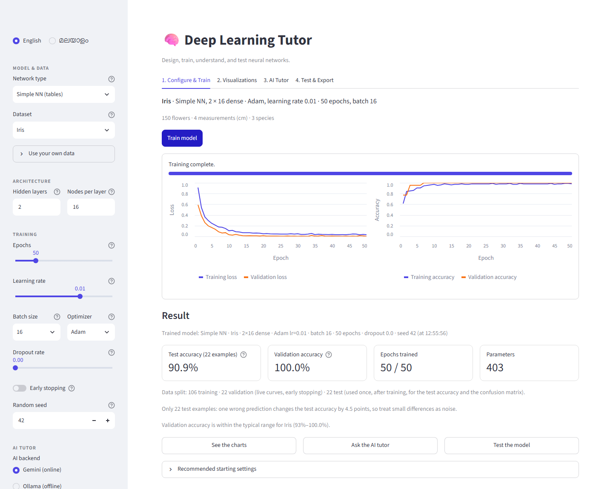
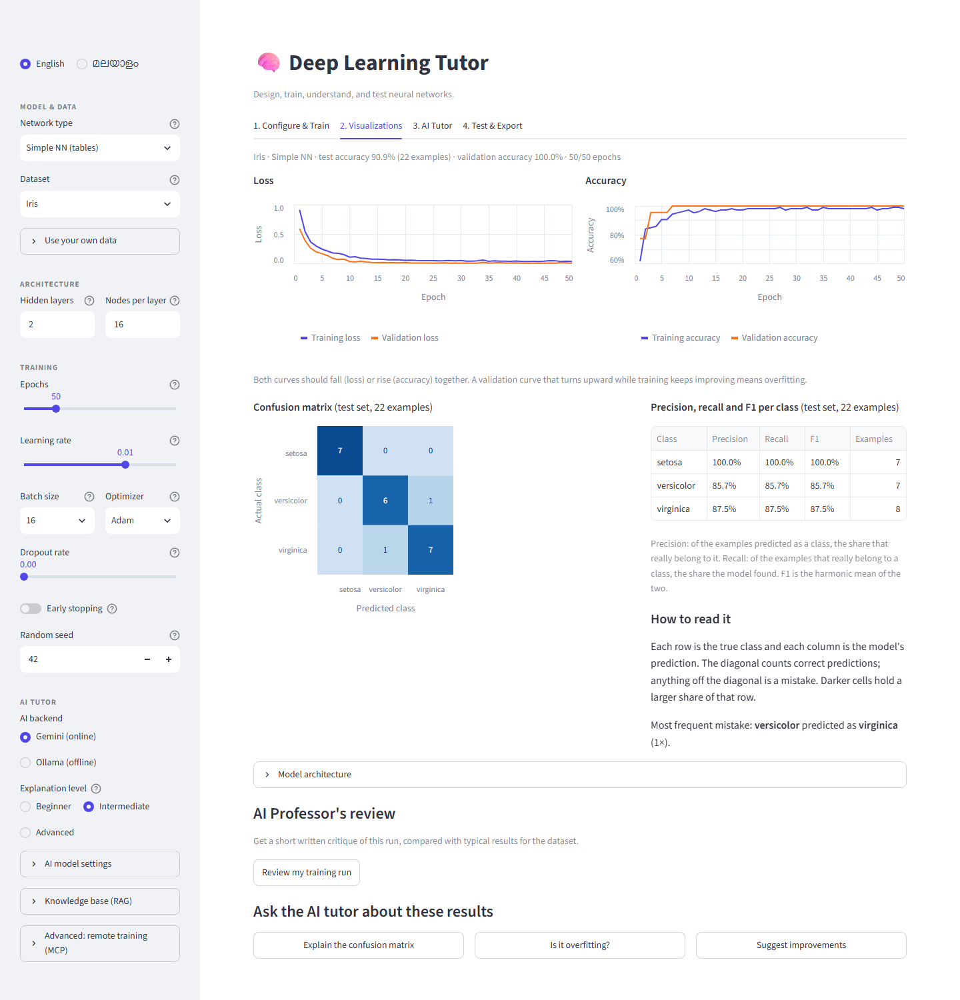
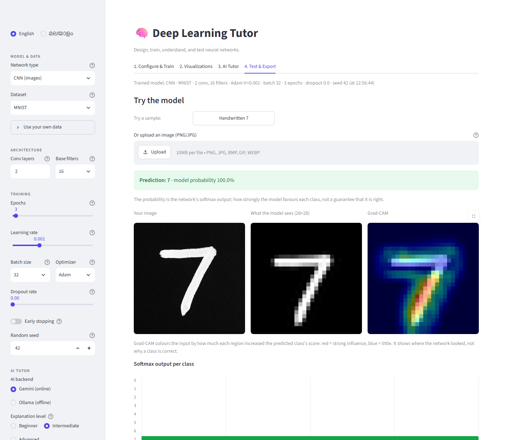
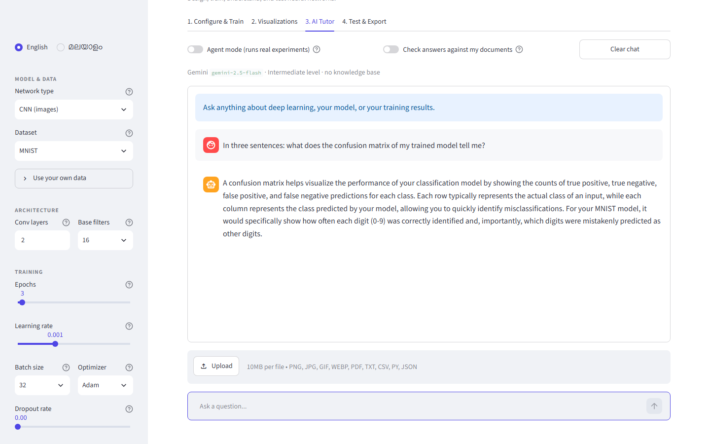
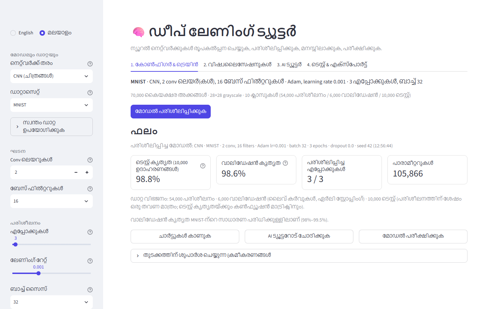

# 🧠 Deep Learning Tutor

[](https://github.com/stredevirad/DeepLearningTutor/actions/workflows/tests.yml)

**Design, train, understand and test small neural networks, without writing code.**

Deep Learning Tutor is a Streamlit app for learning deep learning by doing:

1. Pick a dataset and configure a network in the sidebar.
2. Train it while the loss and accuracy curves update live.
3. Read the results: test accuracy, confusion matrix, precision / recall / F1 per class.
4. Ask an AI tutor about them, in English or Malayalam.
5. Test the model on your own input, see a Grad-CAM heatmap, and export the model.

It is an educational project that runs on a laptop CPU. It is not a production service.

```
Configure  →  Train (live curves)  →  Result  →  Understand (charts, AI tutor)  →  Test & export
```

## Screenshots

| Train: live curves and the result card | Understand: curves, confusion matrix, per-class table |
|---|---|
|  |  |

| Test: prediction and Grad-CAM | Ask: the AI tutor |
|---|---|
|  |  |

The whole interface is also available in Malayalam:



The screenshots are made by [`scripts/demo_walk.py`](scripts/demo_walk.py), which drives the
running app in a real browser and fails if any screen shows an error.

---

## Quick start

Tested with **Python 3.13**, locally on Windows 11 and in CI on Ubuntu. Other Python
versions were not tested for this release.

### Windows (PowerShell)

```powershell
git clone https://github.com/stredevirad/DeepLearningTutor.git
cd DeepLearningTutor
py -3.13 -m venv venv
.\venv\Scripts\Activate.ps1          # if blocked: Set-ExecutionPolicy -Scope CurrentUser RemoteSigned
python -m pip install -r requirements.txt
python -m streamlit run app.py
```

### macOS / Linux

```bash
git clone https://github.com/stredevirad/DeepLearningTutor.git
cd DeepLearningTutor
python3 -m venv venv
source venv/bin/activate
python -m pip install -r requirements.txt
python -m streamlit run app.py
```

Streamlit opens <http://localhost:8501>. Work through the tabs:
**1. Configure & Train → 2. Visualizations → 3. AI Tutor → 4. Test & Export**.

The install is large (TensorFlow: about 1 GB to download). **Training, charts, Grad-CAM and
export work without any API key.** Only the AI tutor needs one of the two options below.

### AI tutor, option 1: Google Gemini (online)

1. Copy the example file: `copy .env.example .env` (Windows) or `cp .env.example .env`.
2. Put one or more Gemini keys in `.env`, separated by commas. The app rotates to the next
   key when one hits its rate limit. Keys: <https://aistudio.google.com/apikey>.

   ```
   GEMINI_API_KEYS=your-first-key,your-second-key
   ```

3. `.env` is git-ignored. **Never commit it.** If a key is ever published, revoke it.

### AI tutor, option 2: Ollama (offline)

1. Install Ollama from <https://ollama.com>.
2. Pull the chat model the app uses by default, and optionally the embedding model for
   semantic search in your documents:

   ```
   ollama pull llama3.2:1b
   ollama pull nomic-embed-text
   ```

3. In the sidebar, under **AI tutor**, choose **Ollama (offline)**.

The offline tutor does not work until a chat model has been pulled. Small local models
answer in English only, and agent mode needs Gemini.

---

## Features

### Train
- **Two network types.** A Simple NN (dense layers) for tables, and a small CNN
  (1–3 conv + max-pool blocks) for 28×28 images.
- **Built-in datasets.** Iris, Wine, Breast Cancer, Digits (tables); MNIST, Fashion-MNIST (images).
- **Your own data**, with a summary in the sidebar before you train:
  - **CSV**: you choose the target column. Numeric columns are standardised, text columns
    with few values are one-hot encoded, ID and free-text columns are ignored and listed,
    rows with missing values are removed and counted, regression-like targets are rejected.
  - **ZIP of class folders** (`cats/…`, `dogs/…`): checked for path traversal, file count,
    size and zip bombs. Limits: 25 MB CSV, 100 MB ZIP, 10,000 images.
- **Hyperparameters.** Layers, nodes or filters, epochs, learning rate, batch size,
  optimizer (Adam, SGD, RMSprop), dropout, early stopping and a random seed.
- **Three data splits, each with one job:**

  | Split | Used for | Tables and uploads | MNIST / Fashion-MNIST |
  |---|---|---|---|
  | Training | the model learns from it | 70 % | 54,000 images |
  | Validation | live curves, early stopping | 15 % | 6,000 images |
  | Test | evaluated **once**, after training: headline accuracy, confusion matrix, per-class table | 15 % | the official 10,000 test images |

  The split is stratified (same class proportions in every part) and fixed by the seed. The
  scaler and the one-hot encoder are fitted on the training rows only. When a dataset is too
  small for every class to appear in all three parts, the app falls back to 80 % training /
  20 % validation and says clearly that its number is a validation accuracy.
- **Honest numbers.** Metrics are computed on the weights the model actually ends up with
  (early stopping restores the best epoch). The size of the test set is shown beside the
  accuracy, and small test sets get a note on how much one wrong prediction moves it.

### Understand
- **Interactive charts.** Loss and accuracy curves (training against validation), the
  confusion matrix on the test set with its most frequent mistake named, precision, recall
  and F1 per class, and the model architecture with parameter counts.
- **AI Professor's review (on request).** A short critique of the run. The verdict
  (below / within / above the typical range for the dataset) is computed in Python, so an
  under-trained model is not praised. **Listen** reads it aloud (gTTS, English or Malayalam).
- **Grad-CAM (on request).** For an image prediction, shows which pixels drove the decision.

### Ask
- **AI tutor chat** at three levels (beginner, intermediate, advanced). Code in answers is
  shown as code blocks. You can attach images, PDFs and text files.
- **Agent mode (Gemini function calling).** The tutor can call five tools and shows each
  call live: `run_experiment` (trains real models), `diagnose_training`,
  `compare_experiments`, `generate_code`, `explain_concept`. Every argument is validated.
- **Knowledge base (RAG).** Upload PDF or TXT study material. Questions retrieve the closest
  passages (cosine similarity on embeddings, BM25 keyword search as the fallback).
- **Document check (optional).** A second LLM call estimates how much of an answer the
  retrieved passages support. Treat it as a signal, not a proof.

### Test & export
- **Predictions.** Upload an image or try the bundled samples; for tables, fill in feature
  values or pick a random test example and compare with its true class.
- **Downloads.** The trained model as `.keras`, and a standalone Python script with the same
  preprocessing, architecture, hyperparameters and seed (see Limitations for what the script
  does not reproduce yet).

### Remote training (optional)
`mcp_server.py` trains the built-in datasets on another machine as background jobs; the app
shows the progress and downloads the model. It listens on `127.0.0.1` by default and
supports a bearer token (`MCP_AUTH_TOKEN`). Start it with `python mcp_server.py --port 8765`,
then open **Advanced: remote training (MCP)** in the sidebar.

---

## Measured results

Measured on 2026-11-12 with `python benchmarks/verify_models.py` on a laptop CPU
(Intel Core Ultra 5 125H, no GPU), seed 42, Python 3.13.0, TensorFlow 2.20.0.

| Configuration | Validation accuracy | Test accuracy | Training time |
|---|---:|---:|---:|
| Iris, 2 × 16 dense, Adam lr 0.01, batch 16, 50 epochs (the defaults) | 100.0 % (22 rows) | **90.9 %** (22 rows) | 1.6 s |
| MNIST, CNN 2 conv × 16 filters, Adam lr 0.001, batch 32, 3 epochs | 98.6 % (6,000) | **98.8 %** (10,000) | 39.6 s |
| Fashion-MNIST, same CNN, 3 epochs | 91.1 % (6,000) | **89.6 %** (10,000) | 35.7 s |

How to read this table:

- **Iris shows why the test set matters.** Validation says 100 %, the test rows say 90.9 %:
  2 of 22 flowers wrong. With 22 rows one mistake is 4.5 points, so small differences on
  Iris mean little, but "100 %" would have been too rosy.
- On MNIST and Fashion-MNIST the two numbers agree to within 1.5 points, as expected with
  thousands of examples.
- No setting was chosen by looking at the test accuracy.

Other checks from the same run:

- The bundled `handwritten_seven.png` is predicted as 7; its Grad-CAM heat lies on the
  stroke 3.1× more than chance.
- Grad-CAM on 300 correctly classified MNIST validation digits: the heat lies on the digit's
  pixels a median 2.3× more than chance; 4 of the 300 maps were empty.
- `fashion_ankle_boot.png` is predicted as Ankle boot. `fashion_sneaker.png` is a line
  drawing, unlike the photos the model was trained on, and is predicted as **Bag**.

Speed of the user interface (for example 184 ms to react to a sidebar switch with a trained
model) was measured earlier, on 2026-09-30 and 2026-10-01, and is documented in
[docs/PERFORMANCE.md](docs/PERFORMANCE.md). Those numbers were not re-measured for this release.

---

## Architecture

A diagram of the modules, and the path of one training run and one tutor question, are in
**[docs/ARCHITECTURE.md](docs/ARCHITECTURE.md)**.

```
app.py                     Streamlit UI: sidebar + four lazy tabs (only the open tab runs)
├── core/                  UI-independent logic (unit-tested)
│   ├── data.py            datasets, train/validation/test split, fit-on-train preprocessing, CSV analysis, safe ZIP loader
│   ├── models.py          Simple NN / CNN builders
│   ├── training.py        config validation, seeding, training loop, evaluation, per-class metrics
│   ├── image_preprocessing.py   one preprocessing for training ZIPs and test uploads
│   ├── gradcam.py         Grad-CAM that works under Keras 3
│   ├── codegen.py         "equivalent Python code" generator
│   └── rag.py             PDF/TXT extraction, chunking, cosine + BM25 retrieval
├── backend/               Gemini (key rotation, retry, cache), agent loop, Ollama
├── components/            live training callback, Altair charts, chat parsing and rendering
├── config/                translations (English + Malayalam), prompts, session-state defaults
├── agent_tools.py         the five tools the Gemini agent can call
├── tts_engine.py          calibrated training review + speech
├── mcp_server.py / mcp_client.py   optional remote training
├── benchmarks/            accuracy and speed scripts
├── scripts/demo_walk.py   browser walk through the app, makes the screenshots
└── tests/                 pytest suite
```

`app.py`, `agent_tools.py` and `mcp_server.py` all train through `core/`, so the split, the
preprocessing, the seeding and the evaluation are the same code everywhere.

---

## Tests

```bash
python -m pip install -r requirements-dev.txt
python -m pytest                 # 450 tests, 2–4 minutes on a laptop CPU
python -m pytest -m "not slow"   # quick subset (no model training)
python -m pyflakes .
```

- **Hermetic.** `tests/conftest.py` blocks every network connection, `.env` is never loaded,
  and every Gemini and Ollama call is faked. The same commands run in GitHub Actions on
  every push.
- **What the tests prove about the data:** the three splits share no rows; the scaler and
  the encoder are fitted on training rows only; the test split is evaluated exactly once
  and only after training; the per-class numbers match scikit-learn.
- **Also covered:** malicious ZIPs, CSV analysis, reproducibility, Grad-CAM, image
  preprocessing, chat parsing, LLM retry and key rotation, RAG, the agent loop and tools,
  the remote-training server, the exported code, translations, and end-to-end runs of
  every tab.

Reproduce the measurements:

```bash
python benchmarks/verify_models.py --out models.json     # accuracy + Grad-CAM (downloads MNIST once)
python benchmarks/run_benchmarks.py --out results.json   # start-up, rerun and component timings
```

---

## Limitations

- **The test set is not carried through every part yet.** The main screen uses it. These
  parts still work with validation numbers, and are labelled as such:
  - the exported Python script makes the older two-way split (80 / 20; for MNIST the
    official test images serve as validation) and prints a validation accuracy, so it does
    not reproduce the app's exact rows or its test accuracy;
  - the AI Professor's review and the tutor's context describe the validation accuracy;
  - the agent's tools rank experiments by validation accuracy (which is correct) but do not
    quote the test accuracy in their comparison, and the remote-training log prints only
    the validation accuracy.
- **Small test sets are noisy.** Iris has 22 test rows; one flower is 4.5 points. There is
  one split per seed and no cross-validation.
- **Deliberately small models.** They train in seconds on a CPU; they are for teaching, not
  for state-of-the-art accuracy. A CNN epoch on MNIST took about 13 s on the test laptop.
- **Out-of-distribution images are guessed badly.** The bundled sneaker drawing is
  predicted as a bag.
- **The document check is an estimate.** An LLM judging another LLM can be wrong.
- **gTTS needs internet access. Ollama models answer in English only.**
- **One user per server.** Training runs inside the user's session; there are no accounts.
- **`app.py` is one long file** (UI only, one function per tab).

---

## Troubleshooting

- **"No Gemini API key found".** Create `.env` from `.env.example` and restart Streamlit.
- **"All Gemini API keys have hit their rate limit".** Wait about a minute, or add more keys.
- **Ollama "server is not running".** Click **Start Ollama server**, or run `ollama serve`.
- **`pip install` fails with "No such file or directory … tensorflow\include\…" on Windows.**
  The folder path exceeds 260 characters. Use a short path (for example `C:\dlt`).
- **Code changes don't show up.** The file watcher is off for speed
  (`.streamlit/config.toml`). Restart Streamlit, or run
  `python -m streamlit run app.py --server.fileWatcherType auto`.

---

## Project history

This project began as an internship project. It was later audited and refactored with the
help of an AI coding assistant: the audit found, among other things, a data leak (the scaler
was fitted before the split) and a Grad-CAM that did not work under Keras 3; the refactor
moved the logic out of the user interface into tested modules. In the private working
repository that work is dated 2026-09-30 and 2026-10-01. The held-out test set and the
per-class table were added for this release.

The public history starts at this release, because the earlier working repository also
held unrelated report material that cannot be published.

## License

[MIT](LICENSE)
