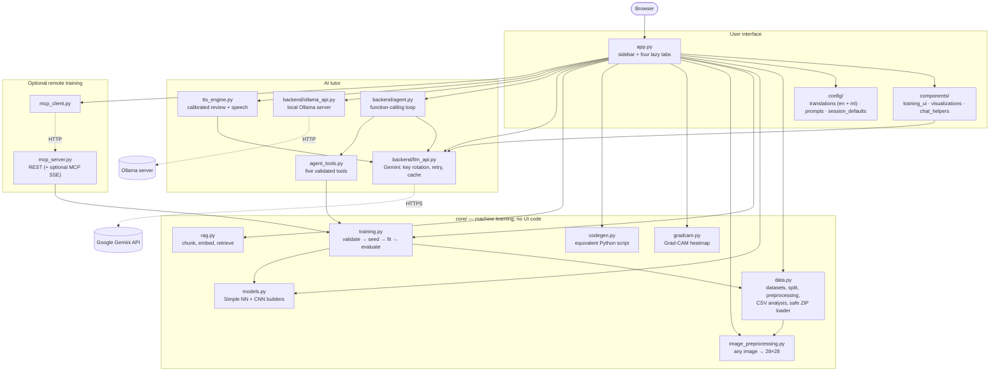
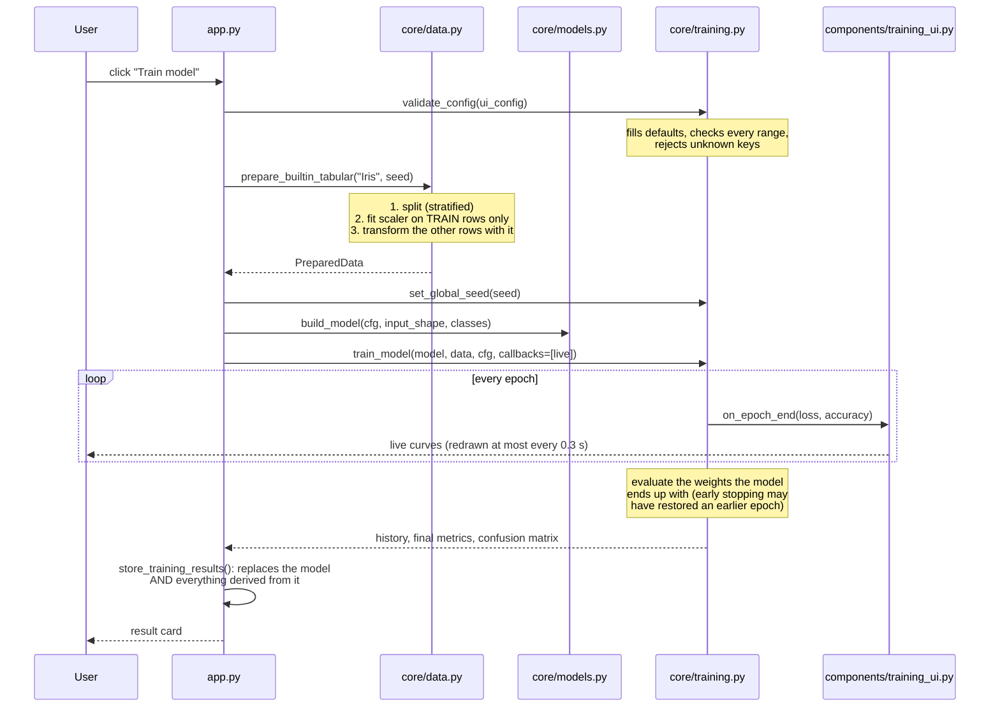
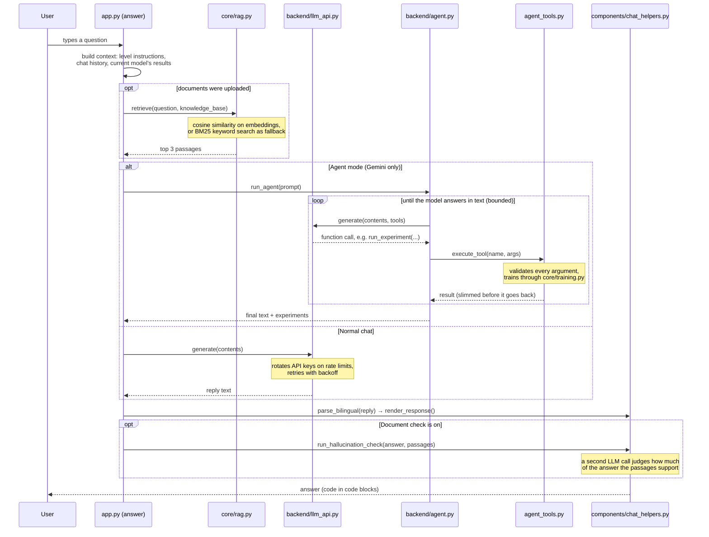

# Architecture

Deep Learning Tutor is one Streamlit app (`app.py`) on top of three small packages.
The rule that keeps it tidy: **`app.py` only draws the user interface; everything that
can be tested without a browser lives in `core/`, `backend/` or `components/`.**

## Modules

Three callers train models: the **Train button** (`app.py`), the **AI agent**
(`agent_tools.py`) and the **remote server** (`mcp_server.py`). All three go through
`core/training.py`, so the split, the preprocessing, the seeding and the evaluation are the
same code everywhere.

| Folder / file | What it holds |
|---|---|
| `app.py` | The whole user interface: the sidebar and four tabs. Only the open tab runs. |
| `core/` | Data loading and splitting, model builders, training and evaluation, image preprocessing, Grad-CAM, the code exporter, the document search (RAG). No Streamlit code. |
| `backend/` | Talking to language models: Gemini (`llm_api.py`), the agent loop (`agent.py`), Ollama (`ollama_api.py`). |
| `components/` | UI pieces that are worth testing alone: the live training callback, the Altair charts, chat parsing and rendering. |
| `config/` | Every UI string in English and Malayalam, the tutor prompts, and the session-state defaults. |
| `agent_tools.py` | The five tools the Gemini agent may call. Every argument is validated. |
| `tts_engine.py` | Builds the "AI Professor's review" prompt (the verdict is computed in Python, not by the LLM) and turns text into speech with gTTS. |
| `mcp_server.py`, `mcp_client.py` | Optional: train built-in datasets on another machine. |
| `benchmarks/` | Scripts that measure speed and accuracy. |
| `tests/` | The pytest suite. It is hermetic: no network, no `.env`. |

## The path of one training run

What happens between a click on **Train model** and the result card
(function names are in the files shown):

Details worth knowing:

1. **Split before fit.** `prepare_tabular` splits the rows first and fits the
   `StandardScaler` / one-hot encoder on the training rows only. Fitting on all rows would
   leak information about the evaluation rows into training ("data leakage").
2. **One data pipeline per fit.** `batch_pipeline` builds one repeating `tf.data` stream, so
   Keras does not rebuild an iterator every epoch. On Iris that fixed cost was larger than
   the maths.
3. **Metrics describe the final weights.** With early stopping, Keras restores the best
   epoch's weights. `train_model` therefore re-evaluates the model after `fit` instead of
   reporting the last line of the history.
4. **No stale state.** `store_training_results` calls `reset_trained_model()` first, so a
   new model can never be shown with the previous model's scaler, class names, predictions
   or Grad-CAM images.

## The path of one tutor question

With the **Ollama** backend the same function builds a shorter prompt and calls the local
server through `components/chat_helpers.call_ollama`; agent mode is not available there
because it relies on Gemini's function calling.

## Design decisions in one line each

- **Lazy tabs**: a click reruns only the open tab, so a checkbox change does not redraw
  charts or repeat a prediction. See [PERFORMANCE.md](PERFORMANCE.md).
- **Results are stored, not recomputed**: predictions and Grad-CAM maps are kept per model
  version and image hash.
- **AI calls happen on request**: the review, the speech and Grad-CAM run when their button
  is clicked, so training results appear immediately and no API quota is spent silently.
- **Uploads are identified by content hash** (SHA-256), so an unchanged file is never
  parsed, decoded or embedded twice.
- **Every outside input is validated**: uploaded files (size limits, ZIP path checks),
  LLM tool arguments and remote requests all pass through the same `validate_config`.
